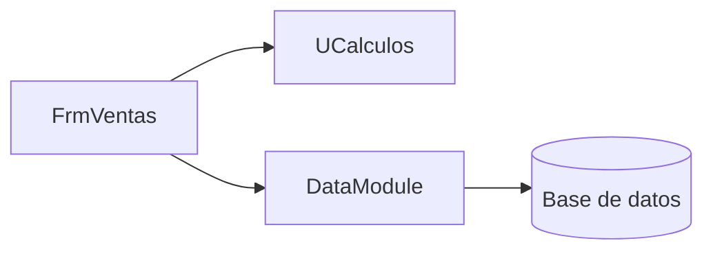
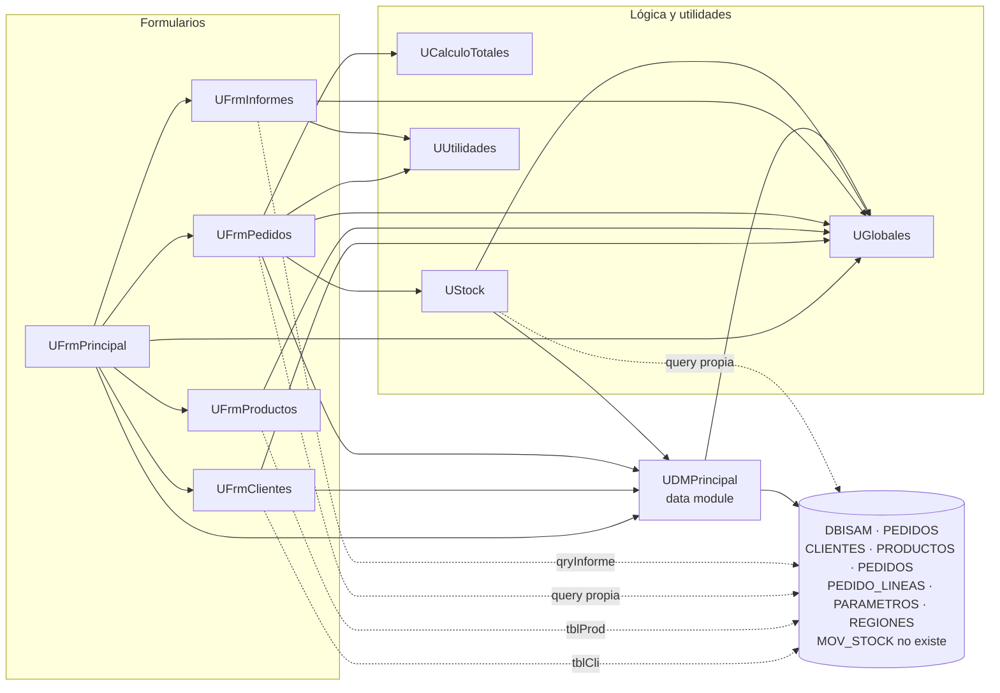

# Dependencias de Pedidos Legado

<!--
Etapa 1 · Entender (plan mode).
Dibuja quién usa a quién: unidades, formularios y la base de datos.
- Una flecha A --> B significa «A usa a B» (lo ves en la cláusula uses o en una consulta SQL).
- Incluye la base de datos (DBISAM) como un nodo: es parte del sistema.
Punto de control E1: el diagrama incluye la base de datos.

Ejemplo genérico (de otro sistema, no de este):

-->

Fuente: cláusulas `uses` de cada `.pas` y componentes con `DatabaseName = 'PEDIDOS'` en los `.dfm`.
Flecha continua = `uses`; flecha punteada = acceso directo a la base (tabla o consulta propia, sin pasar por el data module).
El programa `PedidosLegado.dpr` incluye las 10 unidades y solo crea `DMPrincipal` y `FrmPrincipal`; se omite para no saturar el diagrama.

**Unidades sin dependencias del sistema:** `UGlobales` (no tiene `uses`), `UCalculoTotales` (solo `SysUtils`) y `UUtilidades` (solo `SysUtils` y `DateUtils`). Ninguna de las tres usa formularios ni la base de datos.

## Preguntas guía

1. **¿Qué unidad usan casi todas las demás? ¿Qué pasaría si cambia?**
   `UGlobales`: la usan 7 de las 9 unidades restantes (los 5 formularios, `UStock` y `UDMPrincipal`). Guarda estado compartido que se modifica desde varios lugares (usuario, nivel de permiso, tasa de IVA, ruta de datos, flags de Navidad y modo prueba). Cambiar un valor o el significado de una variable afecta, sin aviso, a pantallas que no se tocaron; por ejemplo, la tasa de IVA se usa tanto en la pantalla como al grabar. Le sigue `UDMPrincipal` (4 unidades), y todas terminan en la base.
2. **¿Qué unidad no depende de formularios ni de la base de datos? ¿Por qué eso importa para migrar?**
   `UCalculoTotales` (y también `UUtilidades`). Son funciones puras: reciben valores y devuelven valores, sin pantallas ni SQL. Se pueden traducir a C# en `PedidosWeb.Core` y probar con xUnit comparando sus resultados con el legado, sin instalar Delphi ni DBISAM. Por eso son el punto de partida más seguro. Ojo: `UFrmPedidos` **no** usa `UCalculoTotales` para el total que graba, sino una copia propia; migrar solo la unidad no reproduce lo que queda en la base.
